# 07 · Website

The Private Chef website: ten pages, each designed for desktop and mobile, in two versions.

- **v1 Waitlist:** before launch. Calls to action collect the waitlist; app buttons say "Soon".
- **v2 Launch:** after launch. Calls to action become "Get started" and "Log in", and the app buttons are live.

Live, interactive preview: https://claude.ai/artifact/5AS2SVKXRHSGfQDTj8NjZi (use the Review switch at the bottom to flip between v1 and v2).

## View it on your computer (no Claude needed)

The website is plain HTML, CSS and JavaScript. It runs in any modern browser, needs no account or subscription, and needs nothing installed for the quick way. On GitHub, or in a file viewer, an `.html` file shows as code; it only looks like the website when a **browser** opens it.

### The easy way: download the website ZIP

1. Sign in to GitHub, then open this link: **https://github.com/Yungdinod/private-chef/raw/main/07-website/Private-Chef-Website.zip**
   (or open [Private-Chef-Website.zip](Private-Chef-Website.zip) in this folder and press the **Download** button, top right of the file view).
2. Unzip it: double-click the ZIP. You get a folder called **Private-Chef-Website**.
3. Open that folder and double-click **`index.html`**. The website opens in your browser, with every page, link and animation.

That link always gives the **newest version**: the ZIP is rebuilt every time the website changes. Download it again whenever you want the latest.

> **Why downloading `index.html` alone doesn't work:** a page file is only the structure. Its styling, animations and photos are in the `assets/` and `img/` folders beside it. Downloaded on its own, it shows as a plain, unstyled page. Always use the ZIP (or the whole repository), and keep the folder together.

### For your terminal (optional)

Get everything once, then update with one command:
```sh
git clone https://github.com/Yungdinod/private-chef.git
cd private-chef
open 07-website/index.html        # Mac: opens the site in your browser
start 07-website\index.html       # Windows
```
Later, to update to the newest version:
```sh
cd private-chef
git pull
```

### Run it like a real website (optional)

Useful for reviews, screen recordings and capturing into Figma. It starts a small local server at http://localhost:8000.

| Computer | What to do |
| --- | --- |
| Mac | Double-click **`start-website.command`** (in the unzipped folder, or `07-website/` in the repository). The first time, macOS may block it: right-click it → **Open** → **Open**. |
| Windows | Double-click **`start-website.bat`**. |
| Any (Terminal) | From the `private-chef` repository folder, run one of the commands below. |

```sh
# Mac or Linux
sh 07-website/start-website.sh

# Or, with Python (built into most Macs)
cd 07-website
python3 -m http.server 8000
# then open http://localhost:8000 in your browser

# Or, with Node.js
npx serve 07-website
```

Keep the Terminal window open while you browse; press **Control + C** to stop. If the Mac asks to install "command line developer tools" for Python, accept it once.

The fonts and the motion library load from the internet, so stay online. Offline, every page still shows, just with system fonts and without animation.

### Other ways

| Where you are | What to do |
| --- | --- |
| On GitHub or your phone | Look at the screenshots below. Tap one to see it full size. |
| Any device, one file at a time | Open a file in [single-file](single-file). Each page has its styles, motion and photos built in, so it works when sent on its own: a phone's file viewer, email, Google Drive. |
| Share a link with someone | Go to https://app.netlify.com/drop (free), sign up, and drag the whole `07-website` folder onto the page. You get a private-ish web address you can open on any phone. Delete the site there when you're done. |
| In Claude | The live preview: https://claude.ai/artifact/5AS2SVKXRHSGfQDTj8NjZi |

### Use the Review switch

At the bottom of every page there is a small **Review** switch: **v1 Waitlist** (before launch) and **v2 Launch** (after launch). It is for design review only and is removed before the site goes live.

## Pages

| # | Page | File | What it does |
| --- | --- | --- | --- |
| 01 | Home | `index.html` | The promise, both services, the menu, trust, chefs, a teaser for chefs |
| 02 | How it works | `how-it-works.html` | Booking step by step, the two services compared, where your money goes, safety |
| 03 | For chefs | `chefs.html` | Earnings calculator, a week as a chef, verification steps, plans, application |
| 04 | About | `about.html` | Mission, story, values, the Lagos launch areas |
| 05 | FAQ | `faq.html` | 19 answers with search and topic filters |
| 06 | Contact | `contact.html` | Email, phone, WhatsApp, support hours, message form |
| 07 | Join | `join.html` | The waitlist (v1) or app download and log in (v2) |
| 08 | Terms | `terms.html` | Terms of use (draft for legal review) |
| 09 | Privacy | `privacy.html` | Privacy policy (draft for legal review) |
| 10 | Not found | `404.html` | Shown for broken links |

## Screenshots

Every page, full length. Desktop is 1440px wide; mobile is a 390px phone. Files are named `<number>-<page>_<version>.jpg` in [screenshots](screenshots).

### Desktop

| Home | How it works | For chefs |
| --- | --- | --- |
| [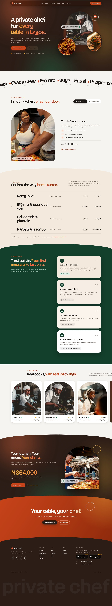](screenshots/desktop/01-home_v1-waitlist.jpg) | [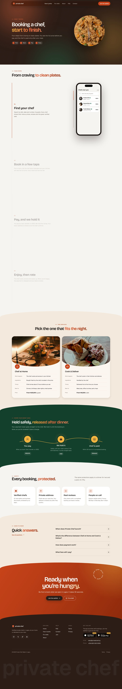](screenshots/desktop/02-how-it-works_v1-waitlist.jpg) | [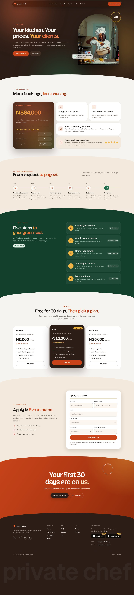](screenshots/desktop/03-for-chefs_v1-waitlist.jpg) |

| About | FAQ | Contact |
| --- | --- | --- |
| [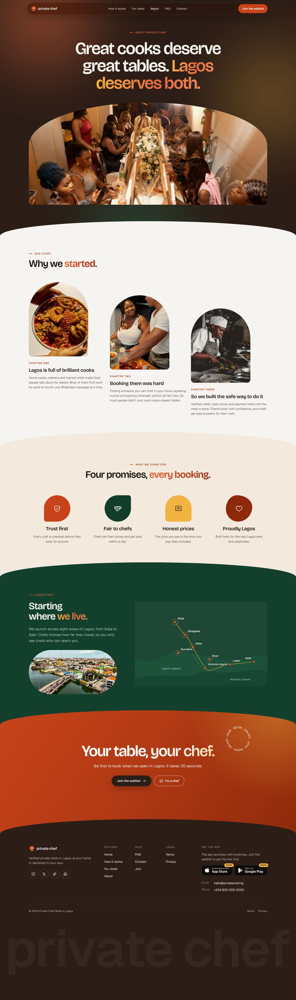](screenshots/desktop/04-about_v1-waitlist.jpg) | [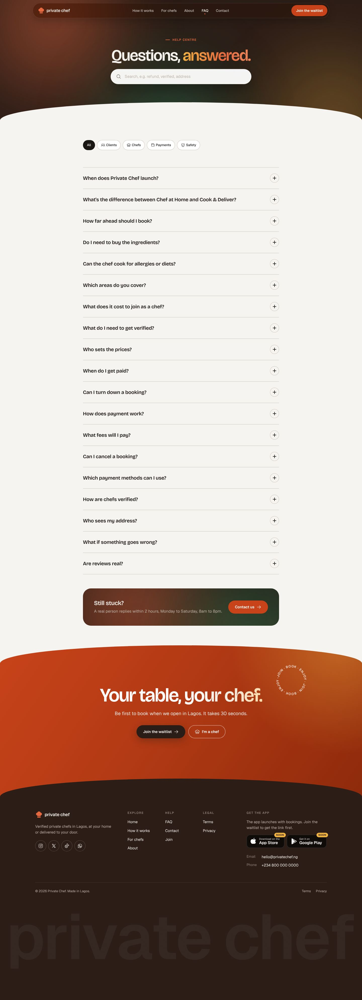](screenshots/desktop/05-faq_v1-waitlist.jpg) | [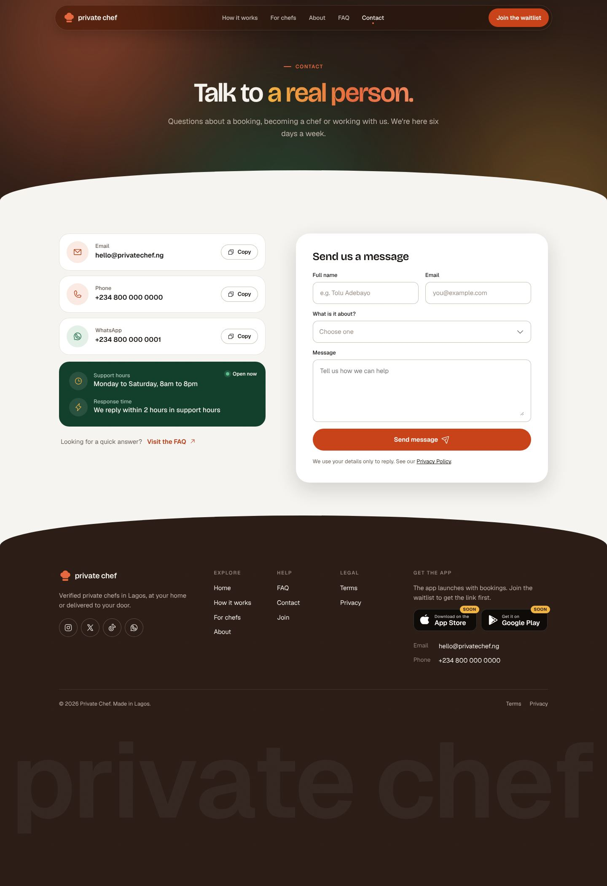](screenshots/desktop/06-contact_v1-waitlist.jpg) |

| Join | Terms | Privacy | Not found |
| --- | --- | --- | --- |
| [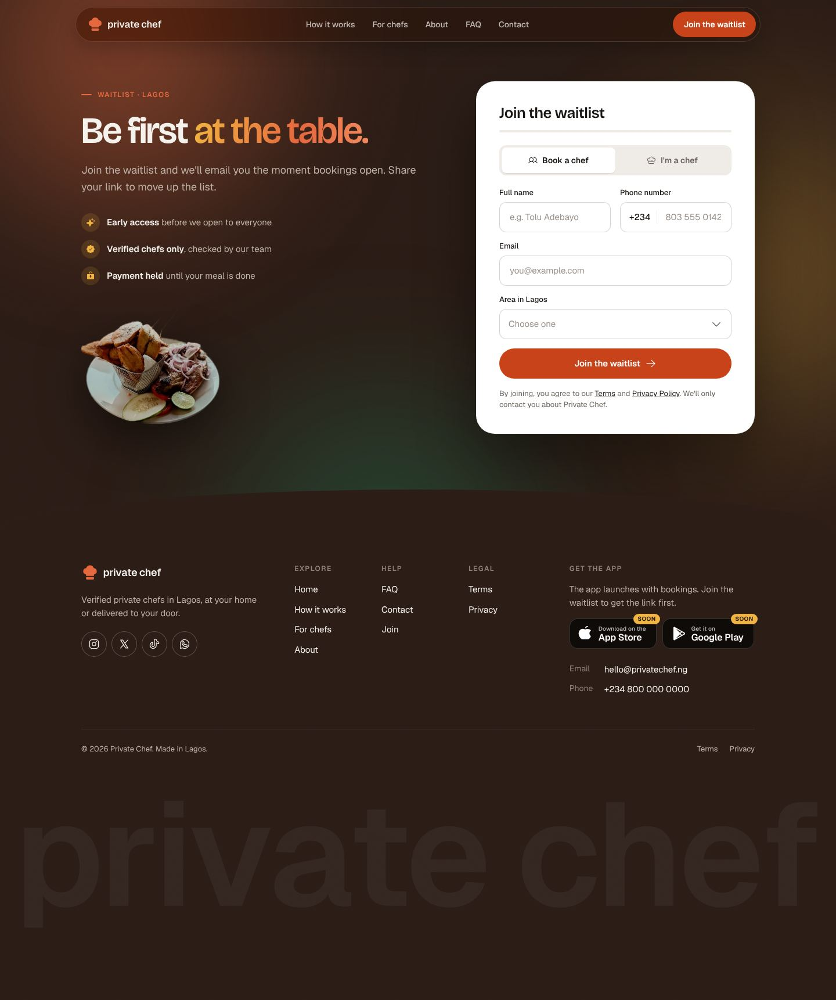](screenshots/desktop/07-join_v1-waitlist.jpg) | [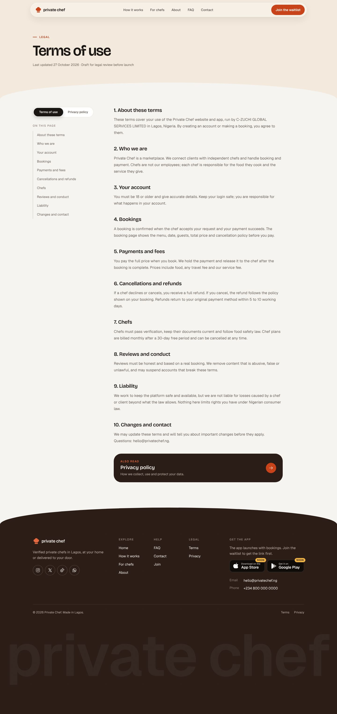](screenshots/desktop/08-terms_v1-waitlist.jpg) | [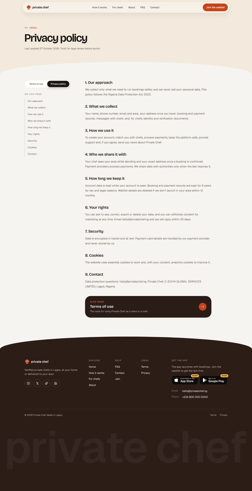](screenshots/desktop/09-privacy_v1-waitlist.jpg) | [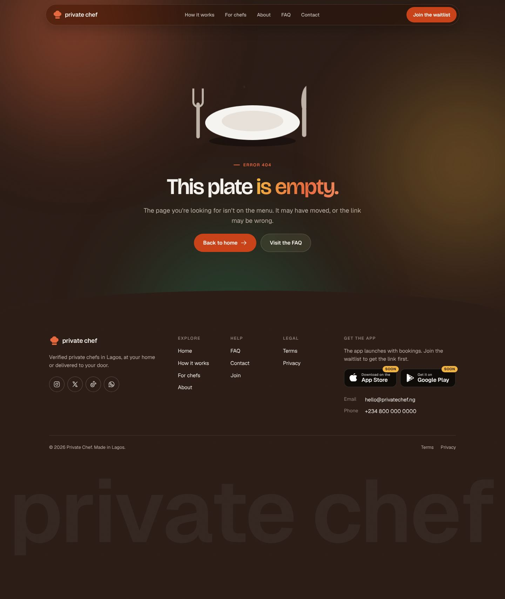](screenshots/desktop/10-not-found-404_v1-waitlist.jpg) |

**v2 Launch versions:** [Home](screenshots/desktop/01-home_v2-launch.jpg) · [For chefs](screenshots/desktop/03-for-chefs_v2-launch.jpg) · [Join](screenshots/desktop/07-join_v2-launch.jpg)

### Mobile

| Home | How it works | For chefs | About | FAQ |
| --- | --- | --- | --- | --- |
| [](screenshots/mobile/01-home_v1-waitlist.jpg) | [](screenshots/mobile/02-how-it-works_v1-waitlist.jpg) | [](screenshots/mobile/03-for-chefs_v1-waitlist.jpg) | [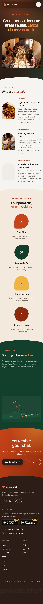](screenshots/mobile/04-about_v1-waitlist.jpg) | [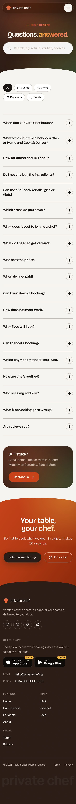](screenshots/mobile/05-faq_v1-waitlist.jpg) |

| Contact | Join | Terms | Privacy | Not found |
| --- | --- | --- | --- | --- |
| [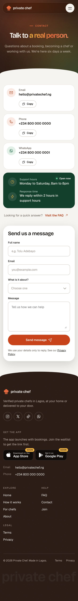](screenshots/mobile/06-contact_v1-waitlist.jpg) | [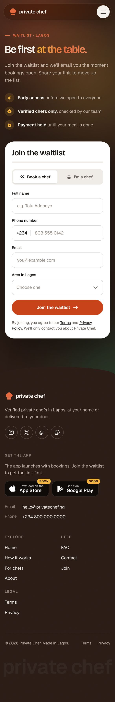](screenshots/mobile/07-join_v1-waitlist.jpg) | [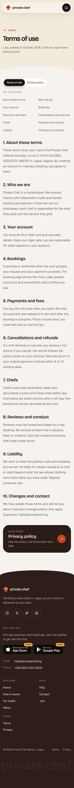](screenshots/mobile/08-terms_v1-waitlist.jpg) | [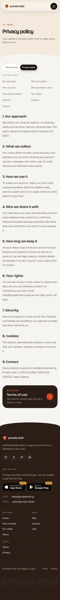](screenshots/mobile/09-privacy_v1-waitlist.jpg) | [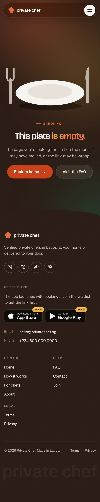](screenshots/mobile/10-not-found-404_v1-waitlist.jpg) |

**v2 Launch versions:** [Home](screenshots/mobile/01-home_v2-launch.jpg) · [For chefs](screenshots/mobile/03-for-chefs_v2-launch.jpg) · [Join](screenshots/mobile/07-join_v2-launch.jpg)

### States

| Mobile menu | Form errors | Form success | FAQ search |
| --- | --- | --- | --- |
| 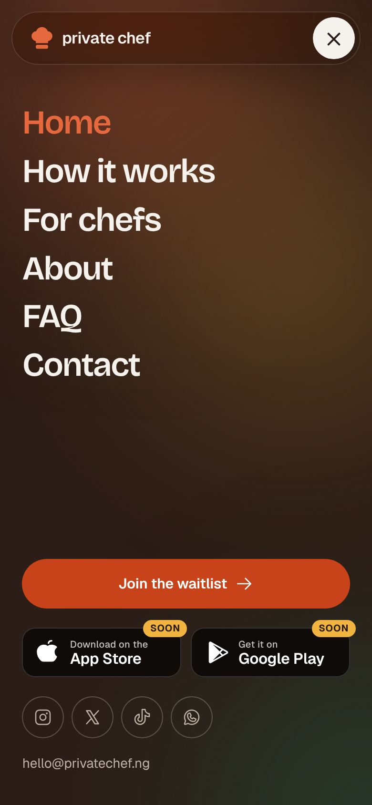 | 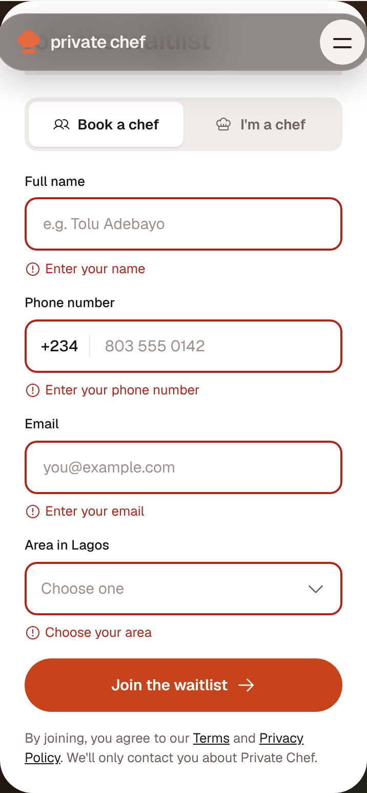 | 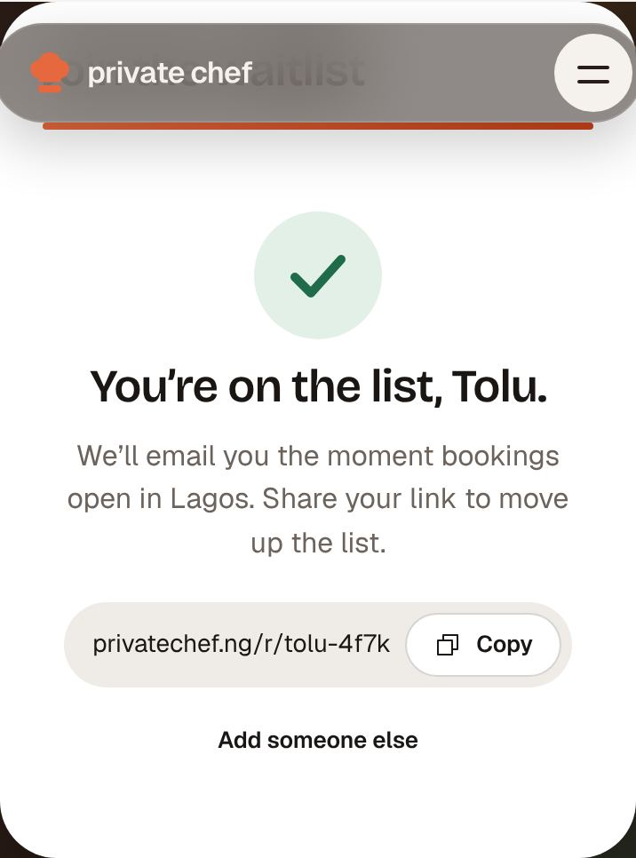 | 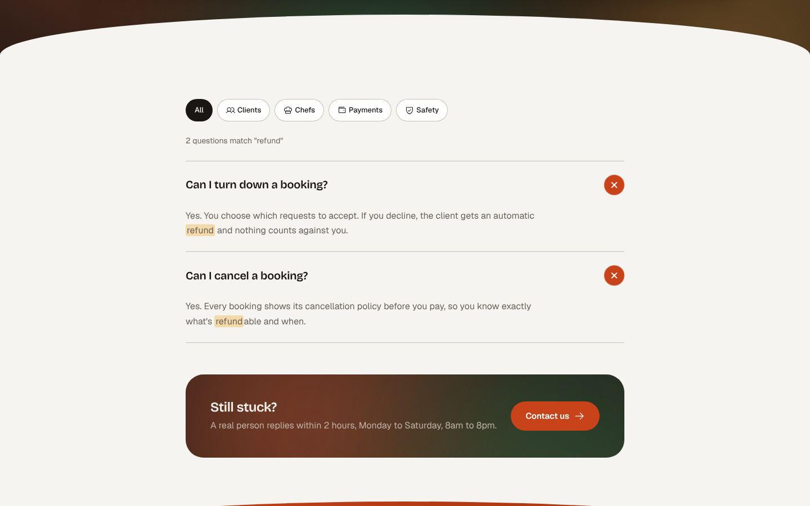 |

Screenshots are still images. Motion (headline reveals, the pinned phone, stacking cards, the curved marquee, page transitions) shows only in the live preview or the HTML files.

## Folder map

| Path | What it is |
| --- | --- |
| `*.html` | The ten pages (open `index.html`) |
| `assets/site.css`, `assets/site.js` | Styles and motion, generated by the build |
| `img/` | Website photos in WebP sizes plus JPEG fallbacks, and dish cut-outs. Credits in `img/CREDITS.md` |
| `single-file/` | Self-contained copy of each page |
| `screenshots/` | Desktop, mobile and state screenshots |
| `src/pages/` | The page content: edit these |
| `src/site.css`, `src/site.js` | Site styles and motion: edit these |
| `src/pages.py` | Repeated blocks (FAQ, forms, plans, chef cards, legal text) |
| `src/build.py` | Builds everything above from `src/` and the design system |

To change the site: edit files in `src/`, then run `python3 07-website/src/build.py` from the repository root.

## Built with

Plain HTML, CSS and JavaScript that a developer can move into any framework. Motion uses GSAP with ScrollTrigger and Lenis smooth scroll, both free for commercial use. Reduce-motion, low-end phones and data saver all get a calmer version with the same content. Mobile first visit to Home is about 1 MB.

Placeholder content to replace before launch: contact details, social handles, chef names, ratings and prices, plan prices, and the photos (to be replaced by a Lagos shoot).
